<a id="TMP_9274"></a>

# Consistent Development Environments with MATLAB® Projects and Package Management

This 90\-minute workshop shows how MATLAB Projects and MATLAB Package Manager create a consistent development environment for people, continuous integration (CI) systems, and AI agents.

<!-- Begin Toc -->

## Table of Contents
&#8195;[Workshop Overview](#TMP_55ac)
 
&#8195;[Workshop Requirements](#TMP_13c8)
 
&#8195;[Step 1: Open the MATLAB Project](#TMP_13af)
 
&#8195;[Step 2: Run the Flight Sensor App](#TMP_624e)
 
&#8195;[Step 3: Install a Package Dependency](#TMP_61fd)
 
&#8195;[Step 4: Declare a Package Dependency](#TMP_1ea5)
 
&#8195;[Step 5: Close the MATLAB Project](#TMP_002d)
 
&#8195;[Step 6: Remove Directly\-Installed Packages](#TMP_2059)
 
&#8195;[Step 7: Reopen the MATLAB Project](#TMP_8e00)
 
&#8195;[Step 8: Run the Tests](#TMP_19a9)
 
&#8195;[Step 9: Build the Package Interactively](#TMP_42d3)
 
&#8195;[Step 10: Build the Package Programmatically](#TMP_54f6)
 
&#8195;[Step 11: Install the Package You Built](#TMP_68b7)
 
&#8195;[Summary](#TMP_6f11)
 
&#8195;[Additional Resources](#TMP_8e54)
 
<!-- End Toc -->
<a id="TMP_55ac"></a>

# Workshop Overview


MATLAB Projects keep paths, package dependencies, tests, and package metadata together so your code is ready to run without manual setup.

In this workshop, you will:

- Open a MATLAB Project to set up the development environment.
- Run **`FlightSensorApp`**, which has a package dependency.
- Install **`Chart_Examples`** from File Exchange using MATLAB Package Manager.
- Declare **`Chart_Examples`** in **`matlab.toml`** so it is installed when the project opens.
- Build an **`.mltbx`** file from the project to share the app as a package.

<a id="TMP_13c8"></a>

# Workshop Requirements

You need the following to complete this workshop:

- MATLAB R2026b with Statistics and Machine Learning Toolbox™
- The complimentary [MATLAB® Expo 2026 workshop license](https://www.mathworks.com/licensecenter/classroom/expo2026-4)

<a id="TMP_13af"></a>

# Step 1: Open the MATLAB Project

Open the MATLAB Project to add the project folders to the path automatically.

In the Files panel, you can double\-click **`matlab.toml`**.

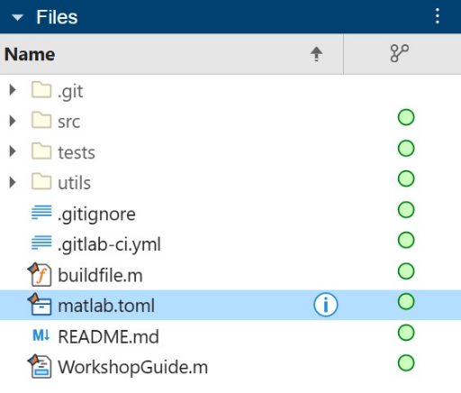

Alternatively, open the project using:

```matlab
openProject(pwd);
```

**NOTE:** You may see a notification introducing you to MATLAB Projects. You can close the notification or select "Do not show this again".

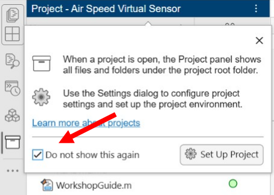

The project folders **`src`**, **`src/app`**, **`src/data`**, **`src/examples`**, and **`utils`** have automatically been added to the path, so the app and its supporting files are ready to run without calling **`addpath`** or custom setup scripts.

In the Files panel, black text folder names indicate folders that are on the MATLAB path compared to the lighter gray text indicating folders and files not on the path..

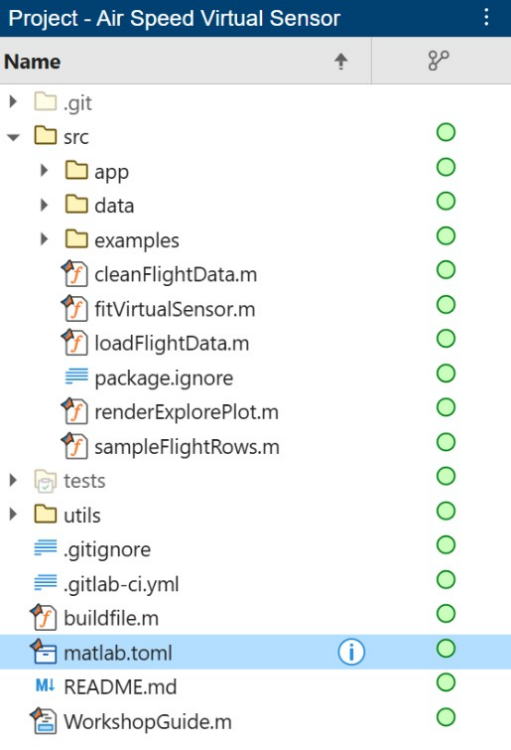

The project is now ready to run the app, helper functions, tests, and workshop utilities.

<a id="TMP_624e"></a>

# Step 2: Run the Flight Sensor App

The Flight Sensor app loads data, cleans sensor data, and trains a machine learning model to act as a virtual sensor. You can launch the app from the **FlightSensorApp** shortcut in the Project tab or by running **`FlightSensorApp`**.

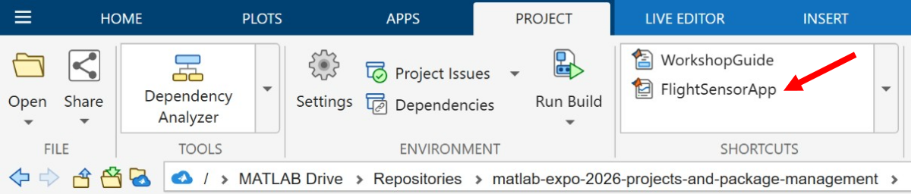

```matlab
FlightSensorApp
```

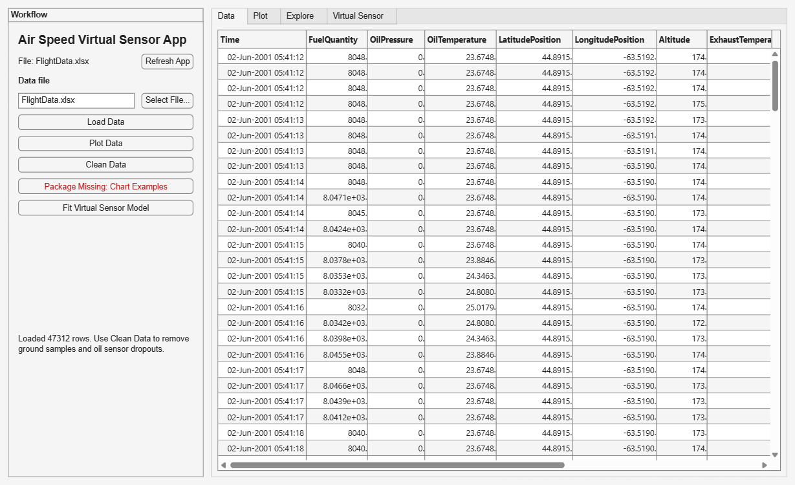

Find the red **"Package Missing: Chart Examples"** button.

Click **Package Missing: Chart Examples** to open the Explore tab and view the custom missing dependency message.

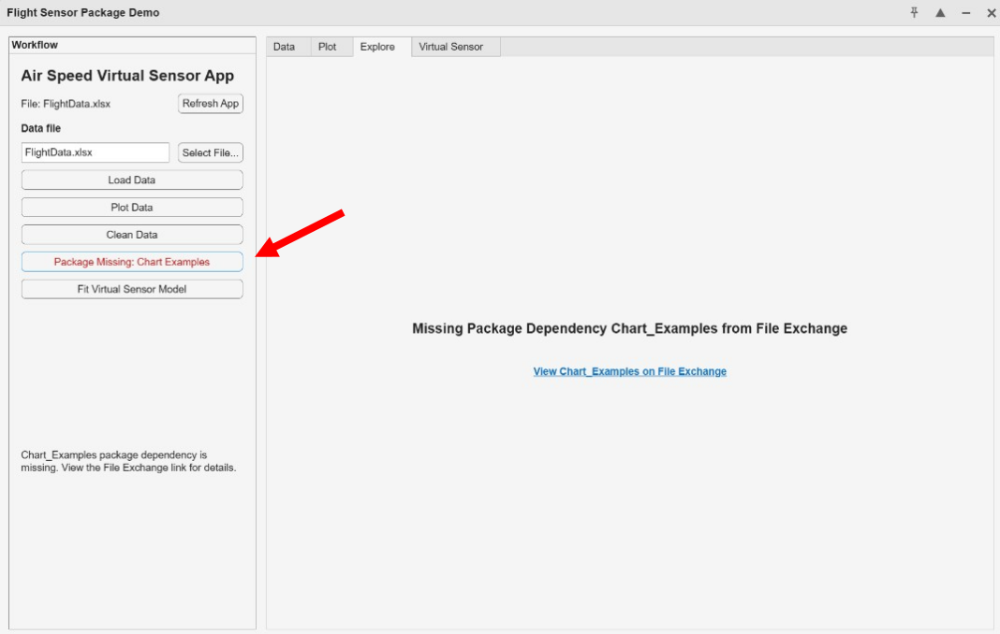

Close the Flight Sensor app and check the available packages.

```matlab
mpmlist
```

```matlabTextOutput
                            Name                               Version      Editable    DirectlyInstalled
    _____________________________________________________    ___________    ________    _________________


    "Air Speed Virtual Sensor (Air_Speed_Virtual_Sensor)"    "0.1.0-dev"     true             true       
```

The only available package is the current **`"Air Speed Virtual Sensor"`** project, shown as version **`"0.1.0-dev"`**. Install **`Chart_Examples`** to enable the Explore Data option in the Flight Sensor app.

<a id="TMP_61fd"></a>

# Step 3: Install a Package Dependency

In R2025a, MATLAB introduced the Add\-Ons side panel for point\-and\-click installation from File Exchange. In R2026b, MATLAB Package Manager also supports installing packages from File Exchange as an API.

View the configured package repositories:

```matlab
mpmListRepositories
```

```matlabTextOutput
               Name                                Location                 
    __________________________    __________________________________________


    "File Exchange Repository"    "https://addons.mathworks.com/registry/v1"
```

File Exchange is configured by default as a package repository in R2026b.

For more information about package repositories, see:

- [mpmAddRepository](https://www.mathworks.com/help/releases/R2026b/matlab/ref/mpmaddrepository.html)
- [mpmRemoveRepository](https://www.mathworks.com/help/releases/R2026b/matlab/ref/mpmremoverepository.html)

Run the following in the Command Window to install **`Chart_Examples`**:

```
mpminstall Chart_Examples
```

**NOTE:** You must approve the installation by typing "YES", "yes", or "y", or by pressing Enter.

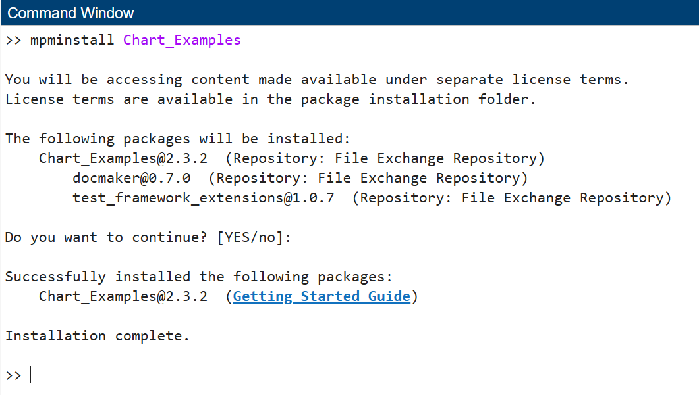

To install packages without a prompt, you can set the optional name\-value argument Prompt to false:

```matlab
mpminstall("Chart_Examples",Prompt=false)
```

```matlabTextOutput
You will be accessing content made available under separate license terms.
License terms are available in the package installation folder.


The following packages will be installed:
    Chart_Examples@2.3.2  (Repository: File Exchange Repository)
        docmaker@0.7.0  (Repository: File Exchange Repository)
        test_framework_extensions@1.0.7  (Repository: File Exchange Repository)


Successfully installed the following packages:
    Chart_Examples@2.3.2  (Getting Started Guide)


Installation complete.
```

```matlab
mpmlist
```

```matlabTextOutput
                                 Name                                    Version      Editable    DirectlyInstalled
    _______________________________________________________________    ___________    ________    _________________


    "Air Speed Virtual Sensor (Air_Speed_Virtual_Sensor)"              "0.1.0-dev"     true             true       
    "Chart Examples (Chart_Examples)"                                  "2.3.2"         false            true       
    "MATLAB DocMaker (docmaker)"                                       "0.7.0"         false            false      
    "Test Framework Extensions Toolbox (test_framework_extensions)"    "1.0.7"         false            false      
```

Use the Add\-Ons side panel to browse installed packages, where you can also filter packages by source

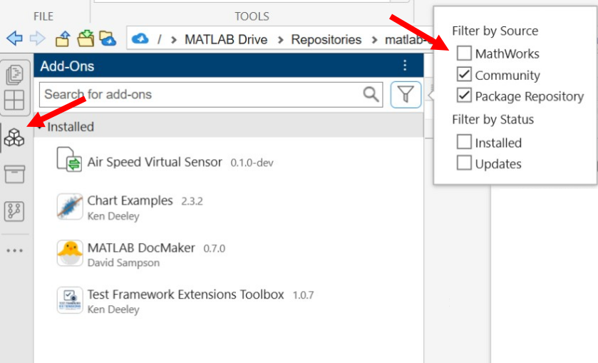

To find the package installation command on a File Exchange submission page, you can open the dropdown menu next to the **Download** button to view the **`mpminstall`** command.

[https://www.mathworks.com/matlabcentral/fileexchange/65857\-chart\-examples](https://www.mathworks.com/matlabcentral/fileexchange/65857-chart-examples)

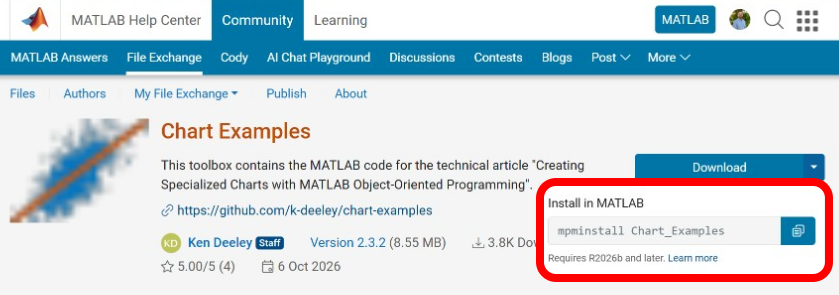

The File Exchange page also provides package author, file, and version information.

Let's Launch **`FlightSensorApp`** again, or if it is still open click **Refresh** to enable the **Explore Data** button now that **`Chart_Examples`** is available.

```matlab
FlightSensorApp
```

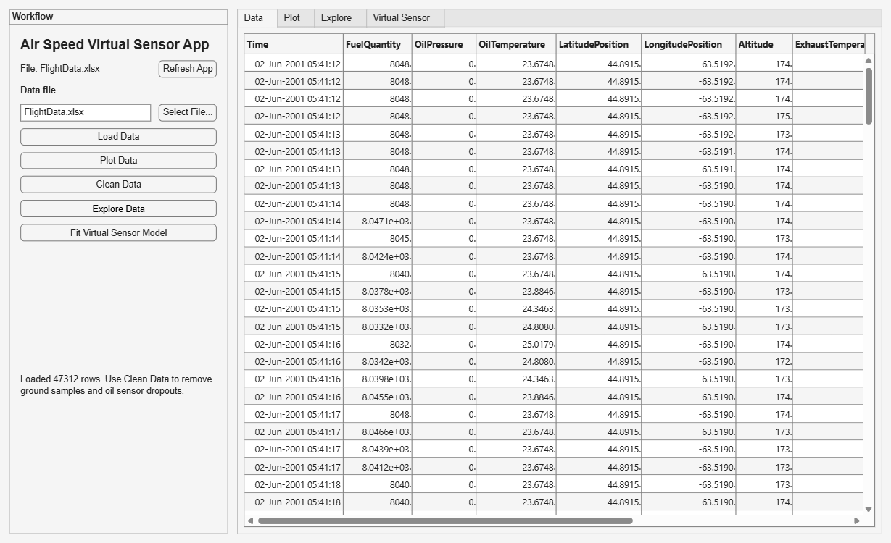

Click **Explore Data** and explore different signals using the custom plotting functions from **`Chart_Examples`**.

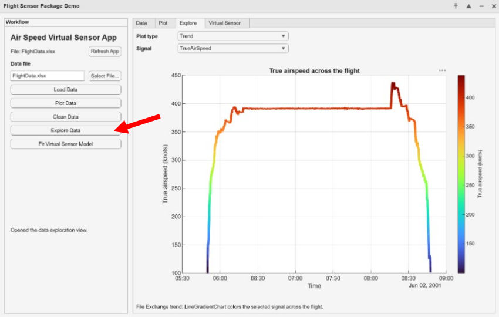

Yay! The missing dependency is resolved for this MATLAB installation. But other users will still encounter the same missing dependency until the project declares what it needs. We can use the **`matlab.toml`** to declare the package dependency, so MATLAB installs it whenever the project opens.

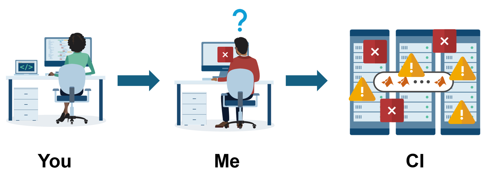

<a id="TMP_1ea5"></a>

# Step 4: Declare a Package Dependency

We need to declare **`Chart_Examples`** version **`>=2.3.2`** in **`matlab.toml`** so MATLAB installs the right version when the project opens.

You can choose one of these options to add the package dependency during the workshop today:

- [Option 1: Add the dependency interactively using the MATLAB Projects toolstrip](#M_7c31)
    - **OR**
- [Option 2: Uncomment the dependency in `matlab.toml` and reload the project](#M_1d99)
    - **OR**
- [Option 3: Run `workshopAddPackageDependencyToProject`](#M_9595)

<a id="M_7c31"></a>
**Option 1: Interactively add package dependency through the MATLAB Projects Toolstrip**

Open **Dependencies** in the Project toolstrip.

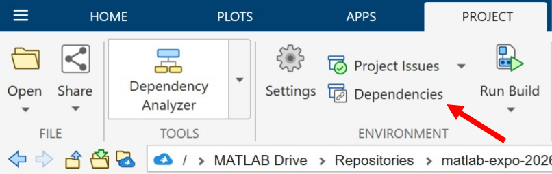

Click **New Dependency**, then **Package Dependency**.

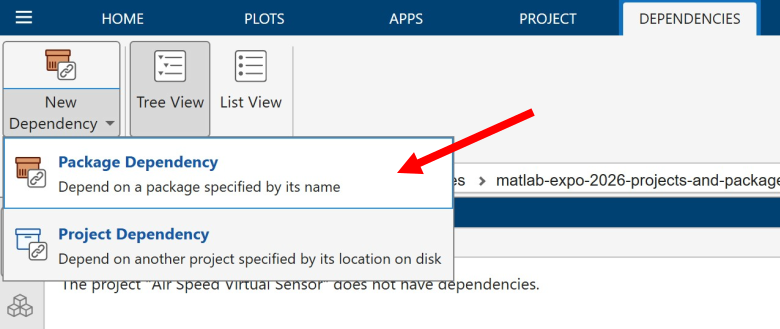

Search for **`Chart_Examples`**, select the package dependency, and set the **Required Version** to be **`>=2.3.2`**.

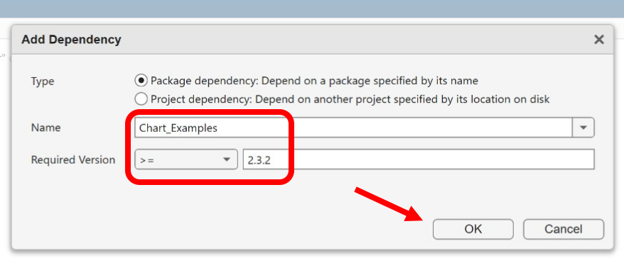

Confirm that **`matlab.toml`** contains:

```
[dependencies]
Chart_Examples = {version = ">=2.3.2", id = "d47c73c1-4864-4beb-93d4-9642d80fcb1b"}
```
<a id="M_1d99"></a>
**Option 2: Uncomment the dependency template in** **`matlab.toml`**

Open the `matlab.toml` file as text using the right\-click context menu and select "**Open as Text**":

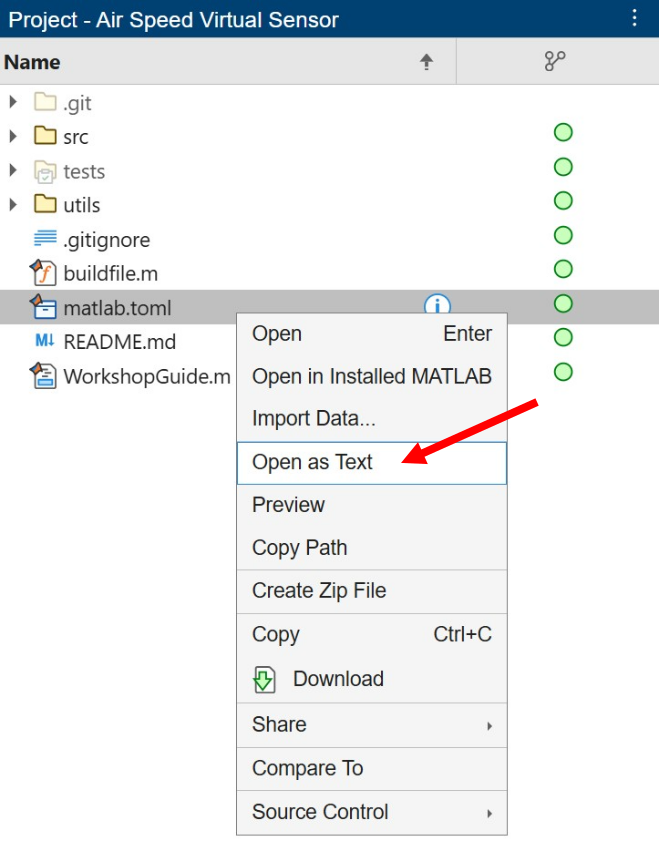

Remove the **`#`** from the **`Chart_Examples`** line in **`matlab.toml`**.

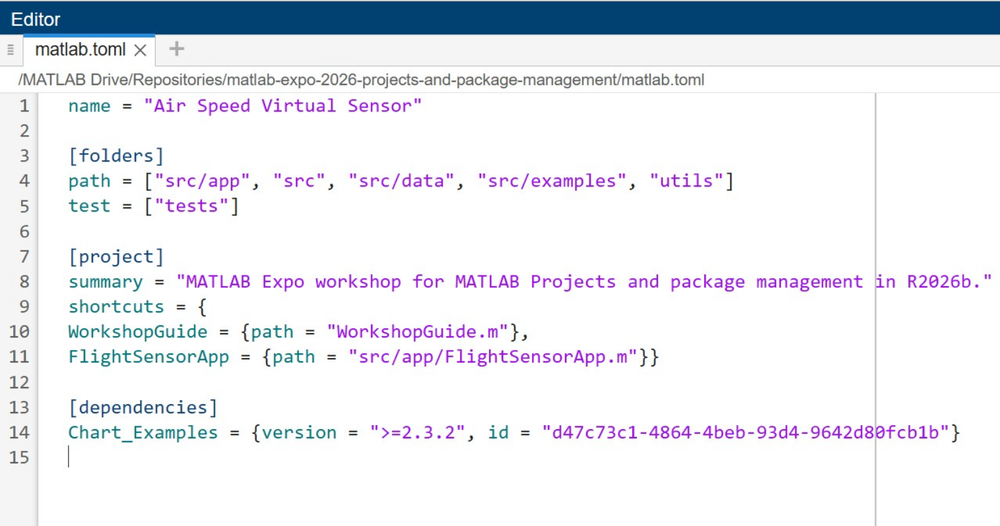

<a id="M_9595"></a>
**Option 3: Run the workshop utility**

Run the utility to uncomment the dependency table:

```matlab
workshopAddPackageDependencyToProject
```

Reload the project to install the declared dependency:

```matlab
proj = currentProject;
proj.reload(Prompt=false);
```

Review the project change by right\-clicking **`matlab.toml`**, "Source Control", and "View Changes" to open a diff report.

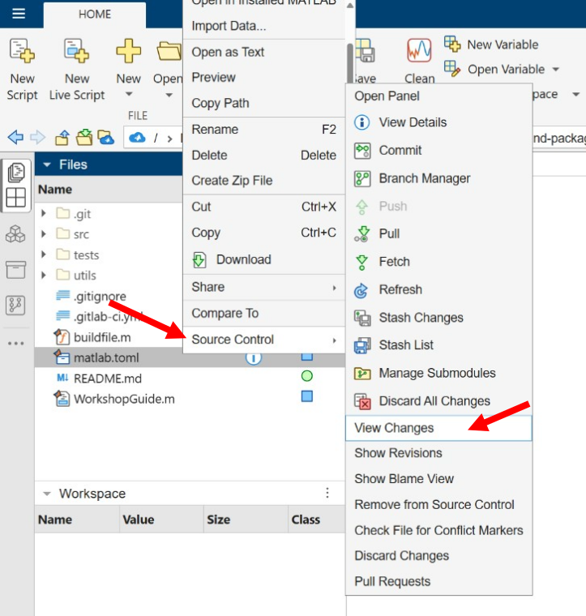

The diff report shows the new **`[dependencies]`** table.

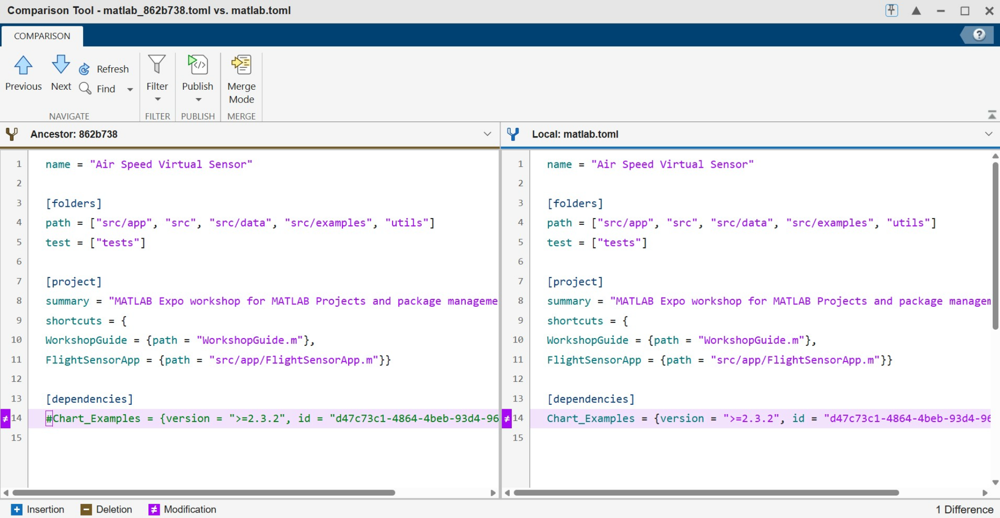

**NOTE:** MATLAB Projects support both package dependencies and reference project dependencies. You should use reference project dependencies if you need to co\-develop two or more code bases together. To create a reference project dependency, first clone the GitHub® repository to another folder or add it as a Git™ submodule.

<a id="TMP_002d"></a>

# Step 5: Close the MATLAB Project

Close the MATLAB Project to remove its folders from the MATLAB path using the Project toolstrip or the MATLAB Projects API.

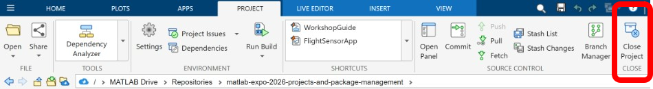

```matlab
proj = currentProject;
proj.close;
```

<a id="TMP_2059"></a>

# Step 6: Remove Directly\-Installed Packages

When you close a project, the project will try to reset its effects on the MATLAB environment. It will:

- Remove its project folders from the MATLAB path
- Close any reference projects it opened
- Uninstall any dependencies the project installed
- Move you back to the folder you started in before you opened the Project.

However if we look at the installed packages, we can see that **`Chart_Examples`** and its dependencies are still installed:

```matlab
mpmlist
```

```matlabTextOutput
                                 Name                                  Version    Editable    DirectlyInstalled
    _______________________________________________________________    _______    ________    _________________


    "Chart Examples (Chart_Examples)"                                  "2.3.2"     false            true       
    "MATLAB DocMaker (docmaker)"                                       "0.7.0"     false            false      
    "Test Framework Extensions Toolbox (test_framework_extensions)"    "1.0.7"     false            false      
```

This is because the project did not install the packages. We installed the packages directly in the Command Window. Uninstall **`Chart_Examples`** which will also uninstall the package dependencies if they are not used by another package.

```matlab
mpmuninstall("Chart_Examples","Prompt",false)
```

```matlabTextOutput
The following packages will be uninstalled:
    Chart_Examples@2.3.2
        test_framework_extensions@1.0.7
        docmaker@0.7.0


Uninstallation complete.
```

Confirm that the global package environment is clean:

```matlab
mpmlist
```

```matlabTextOutput
No matching packages found.
```

<a id="TMP_8e00"></a>

# Step 7: Reopen the MATLAB Project

Reopen the MATLAB Project to restore its paths and declared package dependencies.

```matlab
openProject(pwd,"Prompt",false);
```

```matlabTextOutput
The following packages will be installed:
    Chart_Examples@2.3.2@d47c73c1-4864-4beb-93d4-9642d80fcb1b  (Repository: File Exchange Repository)
    test_framework_extensions@1.0.7@609722db-8fd7-4bbd-b440-c413f25e08c0  (Repository: File Exchange Repository)
    docmaker@0.7.0@ae82d5d2-45be-4fc5-a01b-70d8bb905ca2  (Repository: File Exchange Repository)
```

Verify that **`Chart_Examples`** is installed:

```matlab
mpmlist
```

```matlabTextOutput
                                 Name                                    Version      Editable    DirectlyInstalled
    _______________________________________________________________    ___________    ________    _________________


    "Air Speed Virtual Sensor (Air_Speed_Virtual_Sensor)"              "0.1.0-dev"     true             true       
    "Chart Examples (Chart_Examples)"                                  "2.3.2"         false            false      
    "MATLAB DocMaker (docmaker)"                                       "0.7.0"         false            false      
    "Test Framework Extensions Toolbox (test_framework_extensions)"    "1.0.7"         false            false      
```

Run **`FlightSensorApp`** with the restored development environment:

```matlab
FlightSensorApp
```


<a id="TMP_19a9"></a>

# Step 8: Run the Tests

For this workshop, we are going to use the MATLAB build tool to run our tests and build our package.

The MATLAB build tool is a way to standardize how you build and test your code. It provides a simple API, is integrated with MATLAB Projects in the toolstrip, and makes it easy to do the same thing in CI that you are doing on your desktop. This workshop provides a **`buildfile.m`** which already defines tasks for code checks, tests, and package creation.

To run our tests we can call:

```matlab
buildtool test -ui
```

```matlabTextOutput
** Starting test
.......... ...


Test Summary:
    Total Tests: 13
         Passed: 13
         Failed: 0
     Incomplete: 0
       Duration: 2.7474 seconds testing time.
                 
** Finished test


Build Successful:
    1 Task: 0 Failed, 0 Skipped
    5.1556 sec total build time
```

Or we can use the Run Build button in the Projects tab.

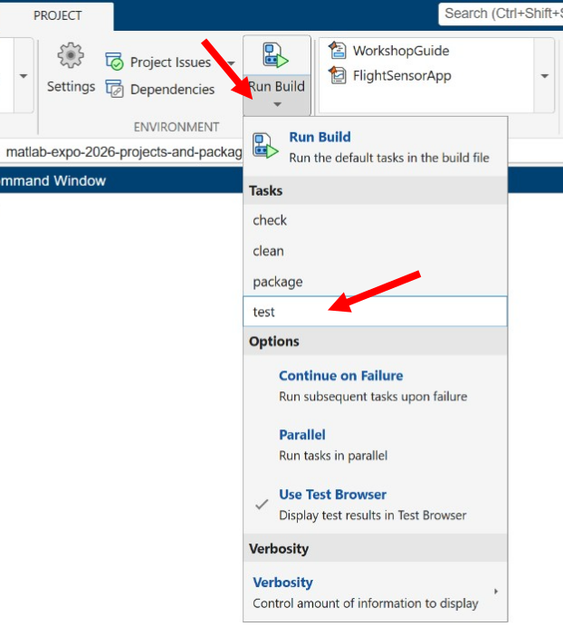

All tests should pass before you package the app and its supporting files.

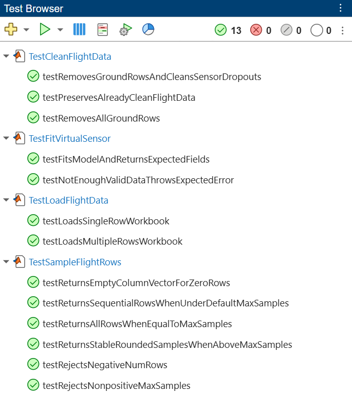

<a id="TMP_42d3"></a>

# Step 9: Build the Package Interactively

Let's package our code to share with others! Create package metadata to share the app and supporting files with other MATLAB users.

Open **Build Package** in the MATLAB Projects toolstrip:

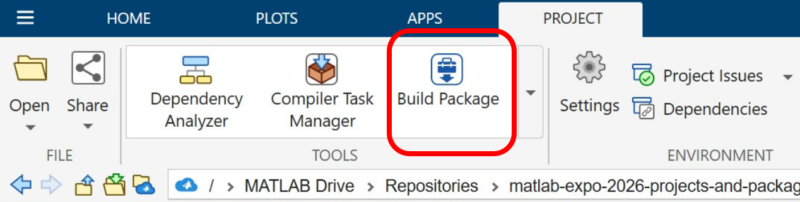

Select **`src`** as the package folder.

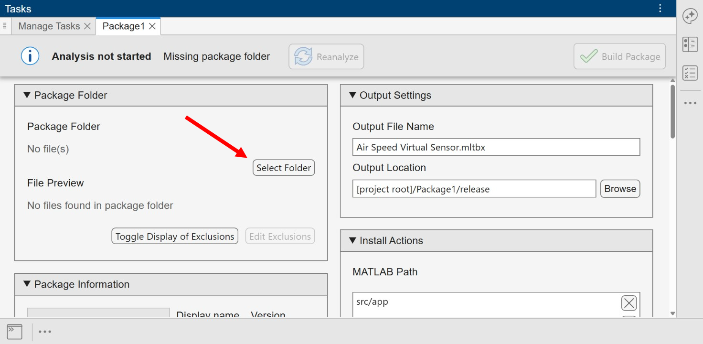

Enter the following package information:

|||
| :-- | :-- |
| **Package Folder**  | **`src`**   |
| **Display Name**  | Air Speed Virtual Sensor   |
| **Version**  | 1.0.0   |
| **Package Name**  | AirSpeedVirtualSensor   |
| **Author Name**  | *Your name*   |
| **Email**  | *Your email address*   |
| **Company**  | *Your organization*   |
| **Summary**  | Explore NASA aircraft flight data and build a virtual airspeed sensor   |
| **Description**  | This MATLAB package provides sample flight data and an app to show how to clean flight data and build a virtual airspeed sensor from other available sensor signals.   |
| **MATLAB Products**  | MATLAB <br> Statistics and Machine Learning Toolbox   |

Alternatively, run **`workshopAddPackageMetadataToProject`** to add the package metadata:

```matlab
workshopAddPackageMetadataToProject
```

Click **Build Package** to generate the **`.mltbx`** file.

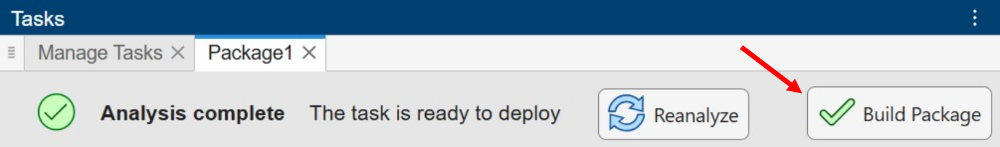

Close the Tasks panel.

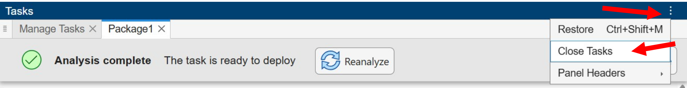

The information entered from the Build Package UI is stored in the **`[[package]]`** section in **`matlab.toml`**. You can review all of the metadata changes by right\-clicking **`matlab.toml`**, selecting "Source Control", and selecting "View Changes".

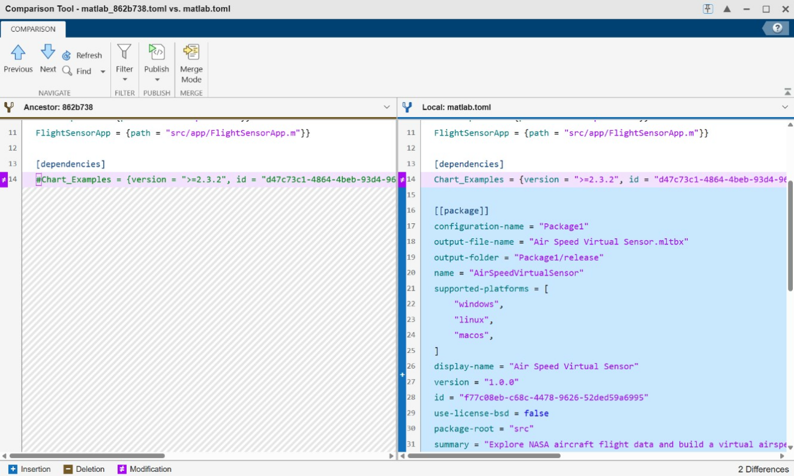

<a id="TMP_54f6"></a>

# Step 10: Build the Package Programmatically

In R2026b, **`PackageTask`** reads the package configuration in **`matlab.toml`** to build the **`.mltbx`** file.

View the **`PackageTask`** already defined in **`buildfile.m`**:

```matlab
edit buildfile
```

Run the package task:

```matlab
buildtool package
```

```matlabTextOutput
** Starting test
.......... ...


Test Summary:
    Total Tests: 13
         Passed: 13
         Failed: 0
     Incomplete: 0
       Duration: 2.699 seconds testing time.
                 
** Finished test


** Starting package
Created package '/MATLAB Drive/Repositories/matlab-expo-2026-projects-and-package-management/Package1/release/Air Speed Virtual Sensor.mltbx'
** Finished package


Build Successful:
    2 Tasks: 0 Failed, 0 Skipped
    5.866 sec total build time
```

Confirm that **`Package1/release/Air Speed Virtual Sensor.mltbx`** exists.

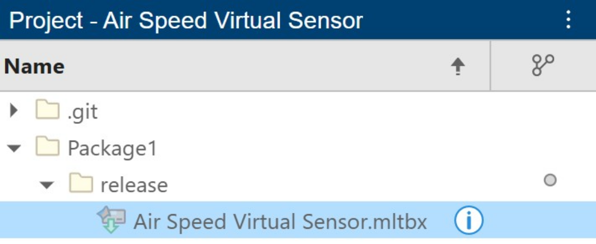

The package is ready to publish to a package repository.

<a id="TMP_68b7"></a>

# Step 11: Install the Package You Built

For the final step, we can install the **`.mltbx`** you just built. Let's start by closing the MATLAB Project.

```matlab
proj = currentProject;
proj.close;
```

Confirm that no packages are installed:

```matlab
mpmlist
```

```matlabTextOutput
No matching packages found.
```

You have two different ways of installing the package during the workshop today:

- [Option 1: Install with point\-and\-click on the **`.mltbx`** file](#M_0cc1)
    - **OR**
- [Option 2: Install with programmatically with **`mpminstall`**](#M_7c9c)

<a id="M_0cc1"></a>
**Option 1: Install with point\-and\-click on the** **`.mltbx`** **file**

Install the **`Air Speed Virtual Sensor.mltbx`** by double clicking on the file.

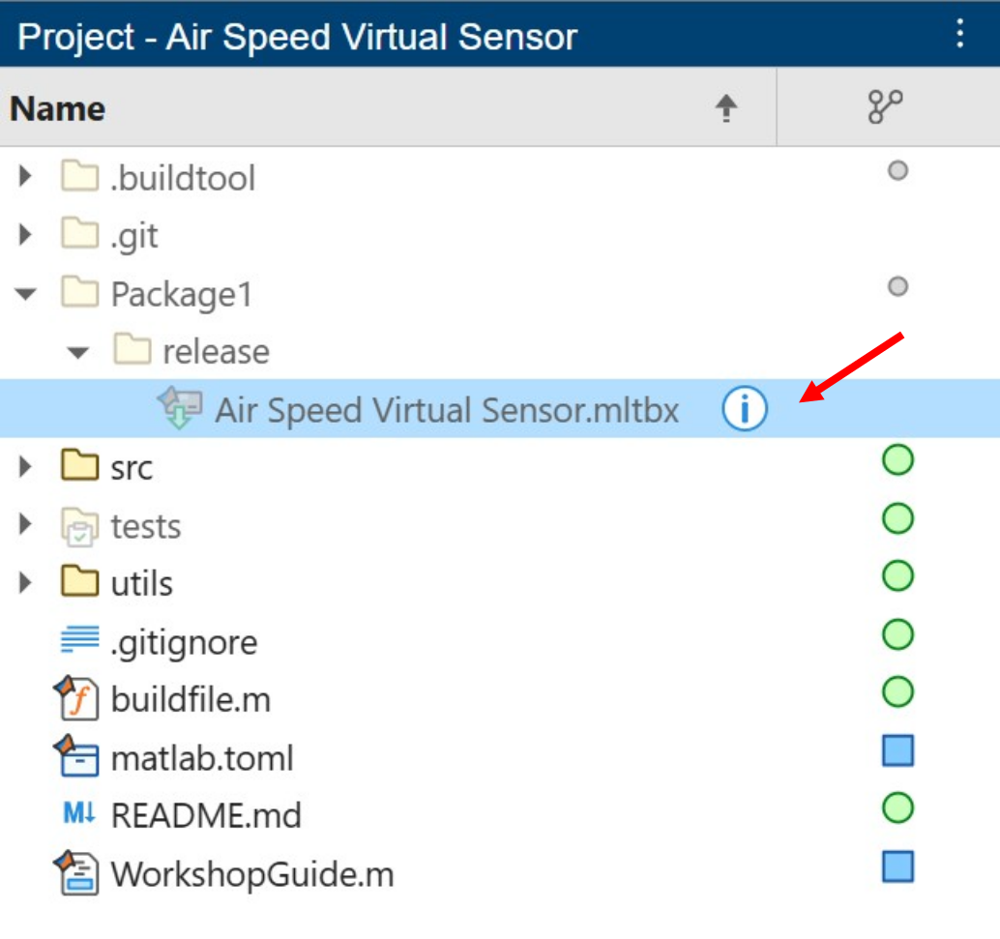

Agree to the license terms of the package and optionally select "Do not show this message again":

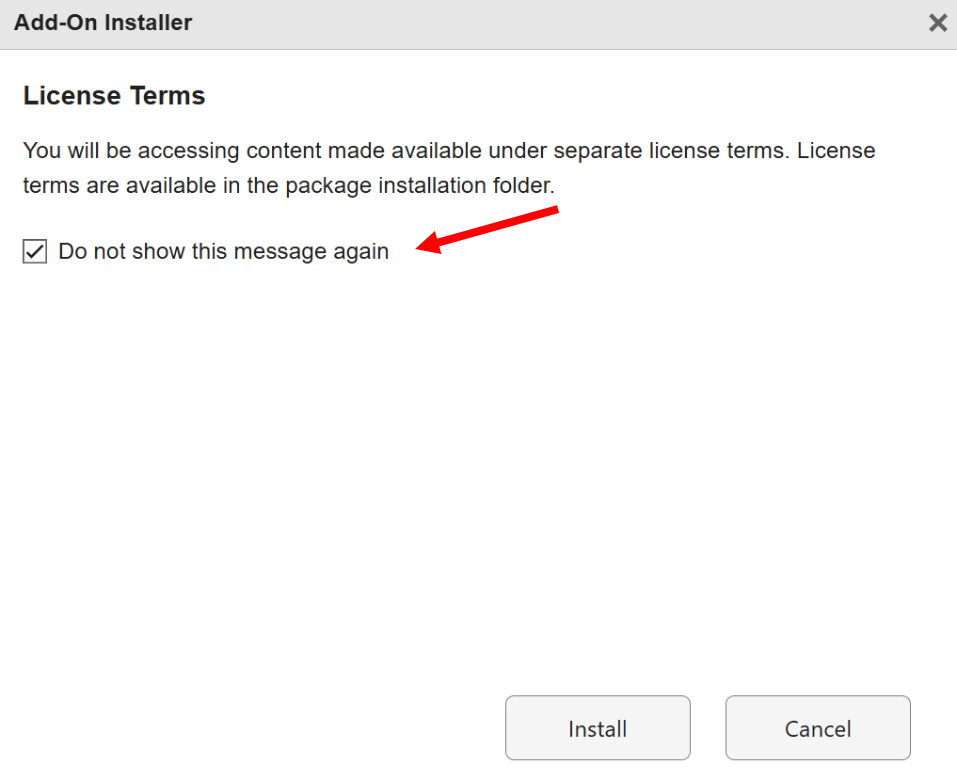

Confirm **Air Speed Virtual Sensor** and the package dependencies will be installed:

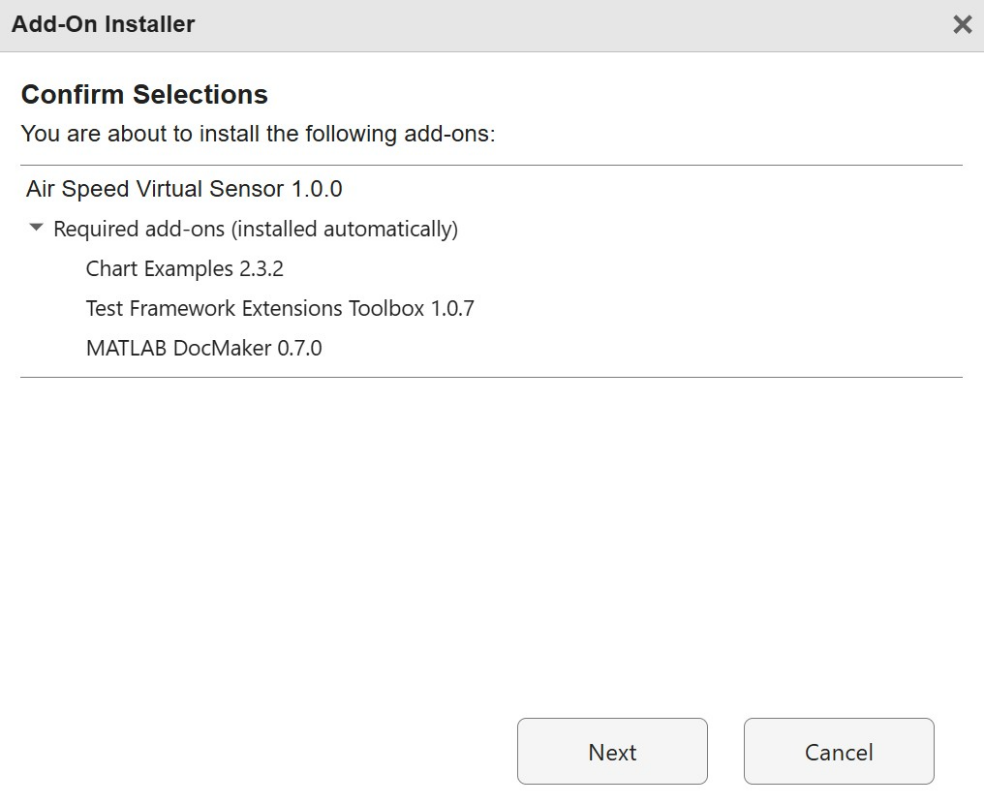

Now **Air Speed Virtual Sensor** is installed and ready to be used.

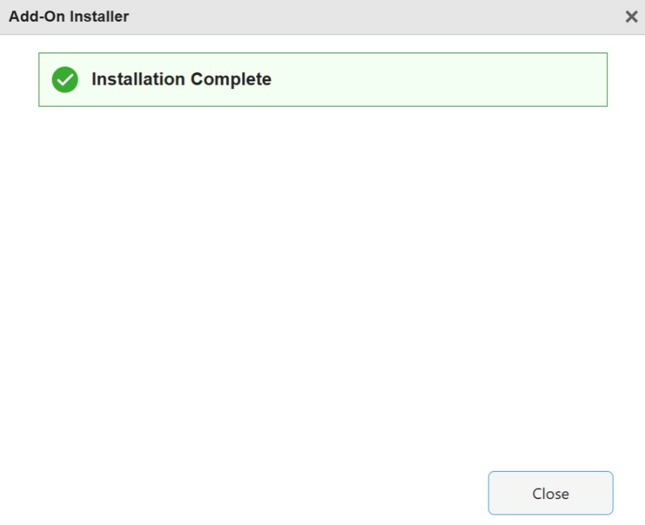

<a id="M_7c9c"></a>
**Option 2: Install with programmatically with** **`mpminstall`**

Install the package programmatically using **`mpminstall`**:

```matlab
mpminstall("Package1/release/Air Speed Virtual Sensor.mltbx",Prompt=false)
```

```matlabTextOutput
You will be accessing content made available under separate license terms.
License terms are available in the package installation folder.


The following packages will be installed:
    AirSpeedVirtualSensor@1.0.0  (Repository: N/A)
        Chart_Examples@2.3.2  (Repository: File Exchange Repository)
        test_framework_extensions@1.0.7  (Repository: File Exchange Repository)
        docmaker@0.7.0  (Repository: File Exchange Repository)


Successfully installed the following packages:
    AirSpeedVirtualSensor@1.0.0  (Getting Started Guide)


Installation complete.
```

Now we can check that the package was installed along with its dependencies:

```matlab
mpmlist
```

```matlabTextOutput
                                 Name                                  Version    Editable    DirectlyInstalled
    _______________________________________________________________    _______    ________    _________________


    "Air Speed Virtual Sensor (AirSpeedVirtualSensor)"                 "1.0.0"     false            true       
    "Chart Examples (Chart_Examples)"                                  "2.3.2"     false            false      
    "MATLAB DocMaker (docmaker)"                                       "0.7.0"     false            false      
    "Test Framework Extensions Toolbox (test_framework_extensions)"    "1.0.7"     false            false      
```

If you ever want to know what a package can do, simply call help on the package name:

```matlab
help AirSpeedVirtualSensor
```

```matlabTextOutput
 AirSpeedVirtualSensor - Explore NASA aircraft flight data and build a virtual airspeed sensor


Contents of AirSpeedVirtualSensor package:
    
      cleanFlightData - Remove ground samples and fill oil sensor dropouts.
     fitVirtualSensor - Fit a lightweight true-airspeed virtual sensor.
       loadFlightData - Import the local NASA aircraft sensor workbook.
    renderExplorePlot - Render the data exploration chart used by the app.
     sampleFlightRows - Return stable row indices for responsive plotting.


Contents of folder app:
    
    FlightSensorApp - Flight Sensor app explores aircraft telemetry and estimates true airspeed from other sensor signals


Contents of folder examples:
    
    ExploreVirtualSensorWithChartExamples - Explore NASA Flight Data
```

The **`.mltbx`** file is the package artifact you publish to a package repository so other users can install it with MATLAB Package Manager.

Now we can simple remove the installed package to clean up the MATLAB environment:

```matlab
mpmuninstall("AirSpeedVirtualSensor",Prompt=false)
```

```matlabTextOutput
The following packages will be uninstalled:
    AirSpeedVirtualSensor@1.0.0
        Chart_Examples@2.3.2
        test_framework_extensions@1.0.7
        docmaker@0.7.0


Uninstallation complete.
```

<a id="TMP_6f11"></a>

# Summary

Congratulations! You have completed the "Consistent Development Environments with MATLAB Projects and Package Management" workshop! In this workshop you:

- Used MATLAB Projects to set up your development environment
- Added **`Chart_Examples`** as a package dependency to the **`matlab.toml`** so that it is installed whenever the project is opened
- Built a MATLAB package that can easily be shared and installed by others as an **`.mltbx`** file

MATLAB Projects keep paths, package dependencies, tests, and package metadata in one **`matlab.toml`** file so that your code ready to run on your machine, a colleague's machine, in CI, and with AI agents.

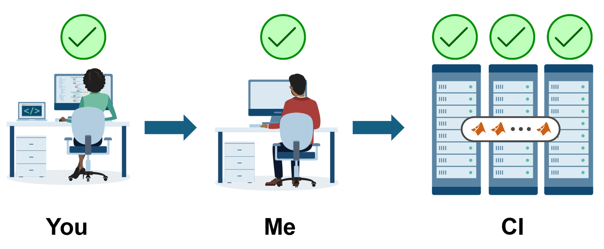

<a id="TMP_8e54"></a>

# Additional Resources
- [Develop and Share Software in MATLAB Overview](https://www.mathworks.com/help/matlab/matlab_prog/recommended-workflow-for-software-development.html)
- [MATLAB Projects TOML Format (**`matlab.toml`**)](https://www.mathworks.com/help/matlab/matlab_prog/toml-format-for-matlab-projects.html)
- [MATLAB build tool new **`PackageTask`**](https://www.mathworks.com/help/matlab/ref/matlab.buildtool.tasks.packagetask-class.html)
- [Install from File Exchange](<https://www.mathworks.com/help/matlab/release-notes.html#mw_a37f87c3-6f2d-48a9-99af-59c3bb05f764>)
- [Share and install packages with custom repositories using MATLAB package repository service ](<https://www.mathworks.com/help/matlab/release-notes.html#mw_a998a4a9-ff19-4276-9c85-c2a69ee20507>)
- [MATLAB Software Development Skills (in MATLAB Agentic Toolkit)](https://github.com/matlab/matlab-agentic-toolkit/tree/main/skills-catalog)

<a id="M_0f4f"></a>
For more information about testing, build automation, and continuous integration (CI), check out the following workshops:

- [Generating Tests for Your MATLAB Code Workshop (GitHub)](https://github.com/mathworks/Generating-Tests-for-Your-MATLAB-Code-Workshop)
- [MATLAB Expo Workshop on Build Automation and CI (GitHub)](https://github.com/mathworks/Expo-2023-Whats-New-for-Managing-Testing-and-Building-your-MATLAB-Code/)
- [Continuous Integration with MATLAB and GitHub Actions Workshop (GitHub)](https://github.com/mathworks/ci-with-matlab-and-github-actions-workshop/)

Copyright 2026 The MathWorks, Inc. MATLAB and Simulink are registered trademarks of The MathWorks, Inc. See mathworks.com/trademarks for a list of additional trademarks. Other product or brand names may be trademarks or registered trademarks of their respective holders.
